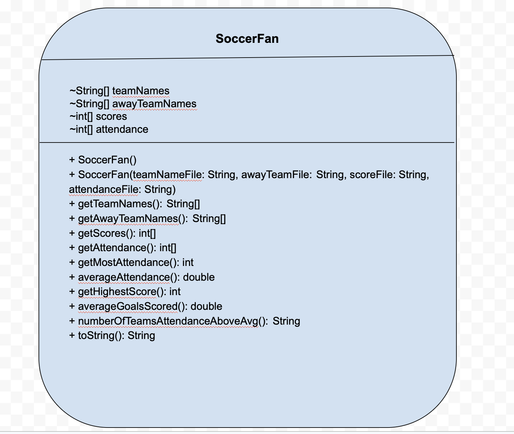

# Unit 2 - Data for Social Good Project

## Introduction

Software engineers develop programs to work with data and provide information to a user. Each user has different needs based on the information they are looking for from data. Your goal is to create a data analysis program for your user that stores and analyzes data to provide the information they need.

## Requirements

Use your knowledge of object-oriented programming, one-dimensional (1D) arrays, and algorithms to create your data analysis program:
- **Write a class** – Write a class to represent your user or business and store and analyze their data with no-argument and parameterized constructors.
- **Create at least two 1D arrays** – Create at least two 1D arrays to store the data that your user needs information about.
- **Write a method** – Write a method that finds or manipulates the elements in a 1D array to provide the information your user needs.
- **Implement a toString() method** – Write a toString() method that returns general information about the data (for example, number of values in the dataset).
- **Document your code** – Use comments to explain the purpose of the methods and code segments and note any preconditions and postconditions.

## User Story 

Include your User Story you analyzed for your project here. Your User Story should have the following format: 

As a soccer fan, I want to find the best team to support so that I can support the winning team?
Question 1: How can I find the average scores in a game and the highest score from a team?
Question 2: Which team has the most attendance of fans?

## Dataset 

Include a hyperlink to the source of your dataset used for this project. Additionally, provide a short description of each column used from the dataset, and the data type. 

Dataset: https://docs.google.com/spreadsheets/d/1idN9ox8OW_ooO6Dx548-GZkWEbcCUxUL8V3VLJ1DVt8/edit?gid=523726883#gid=523726883

- **teamNames** (String) Identify teams and display teams which were home and data regarding it
- **awayTeamNames**  (String) Identify the away team in each match
- **Scores** (int) Find the highest score and average goals scored
- **Attendance** (int) Find the highest attendance, average attendance, and matches above the average

## UML Diagram 

Put an image of your UML Diagram here. Upload the image of your UML Diagram to your repository, then use the Markdown syntax to insert your image here. Make sure your image file name is one work, otherwise it might not properly get displayed on this README. 

 

## Description 

Write a description of your project here. In your description, include as many vocab words from our class to explain your User Story, the chosen dataset and how your project addressed that users goals. If your project used the Scanner class for user input, explain how the user will interact with your project.

Our project is a program designed for a soccer fan desiring to know more information about teams and choosing which one to support. It has many classes, with one class, SoccerFan, containing constructors to create objects about information of the soccer teams. It also has many text files of data. In the SoccerFan class, it creates 1D arrays based off the text files. It also contains methods which iterate through the 1D arrays and use conditionals which check information to then do further actions. For example, calculating which teams have a higher attendance then the average count. It also has a toString method which returns a String displaying information based off calling the methods and using new lines to return information about the app. Finally, a SoccerFan object is created in the main class in the DataRunner file and is printed by using the toString method.